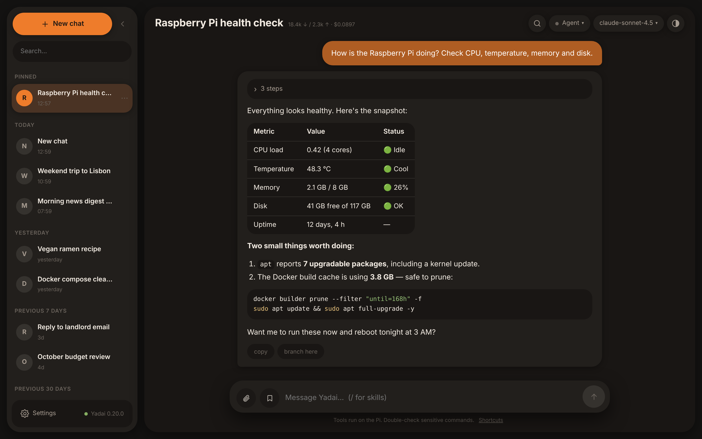
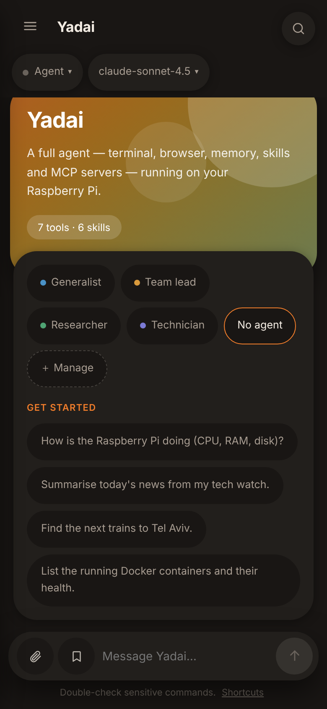
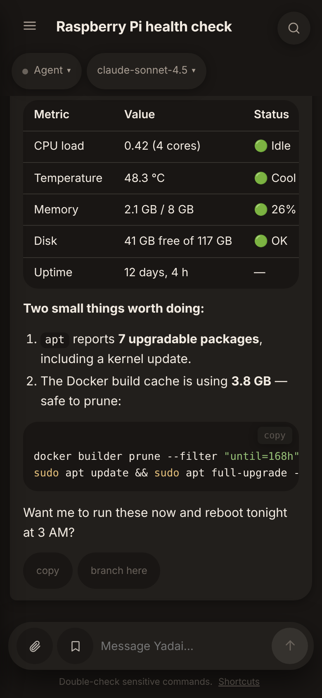
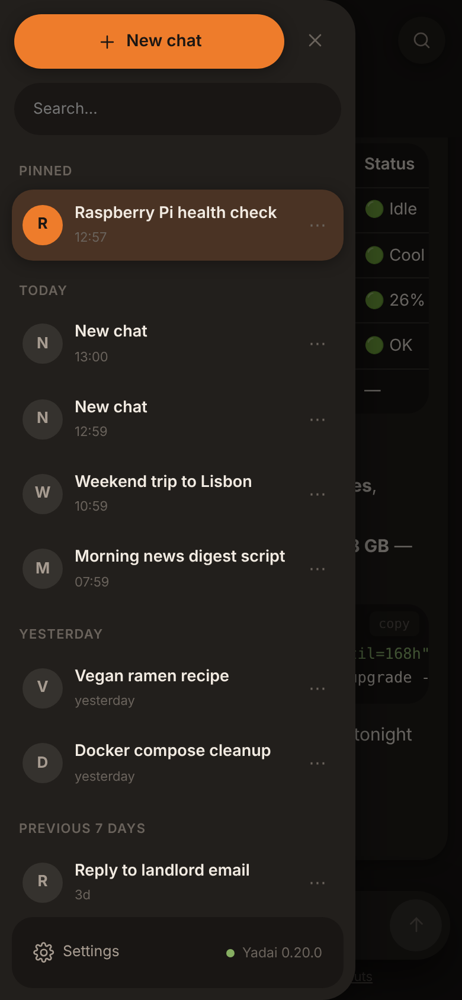

# Yadai

A private, Claude.ai-style web interface for [Hermes Agent](https://hermes-agent.nousresearch.com),
built to run on a Raspberry Pi 5 and replace the Telegram bot without losing
anything: tools, MCP, memory, skills, vision, multi-turn.

**Yadai** is the product — what you open, what the tab says, the icon on the
home screen. **Hermes Agent** remains the name of the engine it drives: the
separate repository on this machine, the gateway on `127.0.0.1:8642`, the
`hermes-gateway` / `hermes-dashboard` services, `~/.hermes/` and the
`HERMES_*` variables. Wherever this file says "Hermes", it means that engine,
never the app.

<p align="center">
  <em>SvelteKit · SQLite · SSE · PWA · Tailscale Serve</em>
</p>

<p align="center">
  
</p>

<p align="center">
  
  &nbsp;
  
  &nbsp;
  
</p>

## What it does

- **Conversation thread** with token-by-token streaming and a typing caret
- **History sidebar** grouped by date (Today / Yesterday / Previous 7 days / …),
  pinning, renaming, archiving, deleting, branching, collapsible on desktop
- **Settings in one place**: the foot of the sidebar is a single door, behind
  which everything is grouped into three families — conversations, agent, app
- **Drawn icons, not emoji**: about forty paths on a 24×24 grid, in
  `currentColor`, so they take the colour of their control and of the active
  palette. An emoji is a font: every platform draws its own, in colours the
  theme has no say over
- **Trash**: deleting a conversation no longer destroys it. It waits 30 days,
  with the countdown shown, and restores exactly where it was — nothing was
  erased in Hermes meanwhile, which is what makes the restore faithful. An
  "Undo" in the toast catches the gesture within the second; "Delete forever"
  is the only irreversible action, and the only one that asks for confirmation
- **"Archived" view**, rebuilt on demand: the gateway API excludes archived
  conversations from all of its lists, so the app finds them one by one from
  the ids it has already seen
- **Command palette** `⌘K` (⌕ button in the header): accent-insensitive search
  over conversation titles + quick actions
- **Search in the open conversation**, in the same palette: from two
  characters on, it lists the thread's messages containing what you type, with
  an excerpt; picking one scrolls the thread to that message and highlights it
  for a moment. It is the only way to find a passage on a phone, where an
  installed PWA has no "find in page"
- **Search in *other* conversations**, in the same palette:
  "Search “…” in other conversations" (or `⌘↵`) reads the transcripts on the
  server — Hermes has no search route — and returns the passages found, with
  the name of their conversation. Picking one opens that conversation **and**
  scrolls to the message. Explicit and never fired on each keystroke: it is one
  upstream read per conversation, capped at the 40 most recently active
- **Timeline of the agent's steps**: every tool call (terminal, web, browser,
  MCP…) shown live, collapsible
- **Status panel** `⌘/`: readiness checks (database, model, disk, gateway,
  platforms), exposed tools/skills, scheduled tasks, running turns, cost and
  tokens of the conversation
- **The state of the Raspberry Pi**, in the same panel: CPU, load relative to
  the number of cores, memory and uptime — four numbers the Hermes dashboard
  already publishes. Read only when the panel opens, never polled
- **Skills palette**: `/` in the composer
- **Saved prompts** (bookmark in the composer, or `⌘K` → "Prompt: …"): save the
  current message to reuse it in one tap; the library is stored on the server,
  so it is the same on the phone and on the desktop
- **Agent team** (Settings → "Agents", or `⌘K` → "Agent team"): personas, each
  with a name, a role and a system prompt; a conversation belongs to an agent,
  and a "team lead" can hand work to the others through Hermes Agent's native
  delegation
- **Skills editor** (Settings → "Skills", or `⌘K` → "Edit skills"): the
  `SKILL.md` files grouped by category, plain-text editing, guided creation of
  a new skill
- **Providers panel** (Settings → "Providers", or `⌘K` → "Providers"): add or
  replace an API key with online validation, connect an account over OAuth
  (pairing code + polling until approved), disconnect, and change the default
  model — no SSH needed
- **Scheduled tasks** (Settings → "Scheduled tasks", or `⌘K`): give one of your
  agents a recurring task that Yadai runs on its own — schedule picked from
  menus rather than written in cron, then editable, duplicable, runnable right
  away, pausable or deletable
- **Usage** (Settings → "Usage", or `⌘K` → "Usage"): tokens sent and generated,
  estimated cost, models, most-used tools and skills loaded, over 7, 30 or 90
  days, with one bar per day. The figures are the ones Hermes Agent already
  measures in its session database — so they cover **everything** the agent
  did, this interface as well as the CLI, Telegram and scheduled tasks. A zero
  cost is explained (free model, or a price Hermes does not know) rather than
  announced as free, and days are upstream's: cut in UTC
- **Push notifications** (status panel → "Notifications"): when a turn
  finishes while the app is not on screen, the answer arrives on the iPhone or
  the desktop, and a tap opens the right conversation
- **Drafts per conversation**: a message started and not sent stays on its
  conversation — it no longer follows you to another thread, and it is still
  there after a reload or a PWA relaunched by iOS. The sidebar marks
  conversations carrying one
- **Images as input**: paste or drop, sent as base64
- **Text files as input**: dropping, pasting or picking a `.log`, a `.yaml`, a
  `Dockerfile` or any text file inserts it into the message as a code block,
  with its name and the right language. The Hermes Agent API only accepts
  images as attachments — the prompt always accepted text, and this is exactly
  what you used to do by hand. A binary is refused on its content, and nothing
  is ever silently truncated
- **Model picker** across the configured providers, applied to the open
  conversation from the next message. Each row shows what the model costs per
  million tokens — the Hermes catalogue already says so for OpenRouter, Nous
  and Novita — and flags free models. The filter also matches the provider
  name, and the list says how many entries its cap left out instead of making
  them vanish
- **Thinking effort**, in the same menu: `Auto` lets Hermes Agent decide from
  its own configuration, and the six other levels — from `None` to `Max` —
  apply to the open conversation from the next message. It is the lever the
  Hermes API accepts on every turn (`model_options`), the same as the CLI's
  `/reasoning`; the last choice becomes the default for new chats
- **Markdown export** of the conversation
- **Fast start**: the app no longer waits for the model inventory before
  showing the conversation. From the first call to the transcript on screen:
  181 ms → 52 ms
- **Syntax-highlighted code blocks**, with a "copy" button. The grammars
  (37 languages, 164 KB) are only loaded the first time a code block appears,
  not at app start
- **Design**: cards floating on a sunken background, set apart by their
  elevation and never by a line — three shadow levels, tinted with the active
  palette's colour. A gradient welcome card, round badges at the head of each
  list row, a composer detached from the bottom with a circular send button
- **Appearance** (◐ in the header, or `⌘K` → "Appearance"): sixteen named
  palettes, light / dark mode, and two pickable accent colours — everything
  else is derived from them. Twelve come from a poster study, sampled at the
  pixel: Coral, Cream, Pinewood, Lagoon, Mist, Apricot, Raspberry, Mint, Amber,
  Blush, Brick, Ultramarine. Each one is checked by the tests — text at 4.5:1
  on its own surface, focus ring at 3:1 on all three backgrounds. The choice is
  saved on the server, so phone and desktop agree
- **Installable PWA** on phones: full bleed, sheets that slide up from the
  bottom, notch and home indicator respected, a composer that stays above the
  iOS keyboard, 44 px touch targets — including in the chats drawer. On a phone
  the header gives the model and agent pickers a row of their own, and their
  menus open as bottom sheets within reach of a thumb
- **Keyboard shortcuts** (`?` for the list). The whole app works from the
  keyboard: focus enters a panel when it opens, Tab does not leave it, Esc
  closes it and gives focus back to the button that opened it — and every
  control carries a visible focus ring, derived from the chosen accent and kept
  at 3:1 on every background
- **Detaching** a running turn (see the limitation below)

### Robustness

The app stays usable when the gateway is not: offline banner, automatic
reconnection with backoff, and a message that says what to do rather than
copying the upstream error. Transient failures are retried — but only on
reads, never on an agent turn. A local cap on simultaneous turns (3 by default)
protects the Pi before the gateway's own (10) kicks in. The details are in
[CLAUDE.md](CLAUDE.md).

### Agents: a team, and what it costs

An agent is a name, an emoji, a one-line role, a system prompt and — if you
want — a preferred model. Four examples are created on first use: a
generalist, a team lead and two specialists. Everything can be edited,
duplicated and deleted.

That prompt is sent to the gateway **with every message**, from the server.
This is not an implementation detail: the Sessions API never re-reads the
`system_prompt` stored when a conversation is created, and changing a
conversation's model even erases it. Without re-sending it, the personality
would vanish at the second message.

Checking "Can lead other agents" composes, from the chosen agents' cards, the
part of the prompt that describes the team and explains when to call
`delegate_task` — Hermes Agent's delegation tool, with its recursion
(`role: "orchestrator"`). The "See the prompt sent with every message" button
shows exactly the text produced, and the panel draws the team tree. An agent
cannot lead itself, nor form a loop: the offending chain is shown instead of
being saved.

**What it costs.** Each sub-agent is a full agent — terminal included —
started on the same four-core Raspberry Pi 5. Two or three in parallel are
felt. And a sub-agent sees nothing of the conversation: the team lead has to
write everything down for it.

**What it does not do.** Sub-agents are not streamed into the thread: on the
Sessions API, a delegation shows up as a `delegate_task` tool step with its
result — `subagent.*` events only exist on the Runs API, ruled out for other
reasons. The depth and number of simultaneous sub-agents are set in
`~/.hermes/config.yaml` (`delegation.*`), not here.

### Skills: what the editor does, and does not do

The editor works on the **files** in `~/.hermes/skills`
(`<category>/<skill>/SKILL.md`, plus one `DESCRIPTION.md` per category), not on
what the gateway has loaded in memory. One consequence to know: **a skill
created or renamed is not necessarily picked up right away** —
`systemctl --user restart hermes-gateway` settles it.

Deliberately narrow scope: only `SKILL.md` and `DESCRIPTION.md` can be read
and edited, there is no deletion, files over 256 KB are sent back to the
command line, and the hidden files of Hermes Agent's automatic sorting
(`.bundled_manifest`, `.curator_state`) are neither listed nor reachable.
Without the `/skills` mount (see `docker-compose.yml`), the panel shows as
turned off instead of breaking.

### Providers: where the keys go

The panel touches no file itself. It proxies the **Hermes dashboard**
(`hermes-dashboard.service`, on `127.0.0.1:9119`), the only thing that knows
how to write a key correctly: `~/.hermes/.env` **and** the copies `config.yaml`
keeps of it (`model.api_key`, `auxiliary.*.api_key`, `custom_providers[*]`).
Those copies take precedence, so writing `.env` alone would let the old key
keep authenticating after a rotation.

Two tabs, following the Hermes Agent catalogue's own split: **API keys** (an
environment variable to paste) and **Accounts** (an OAuth connection). A third
tab changes the **default model** — the one in `config.yaml`, which only
applies to new chats; for the open conversation, use the picker at the top of
the screen.

What the panel does not do: show a key in clear text. The dashboard only
returns a redacted value (`sk-o...60c6`), its reveal route is not proxied, and
no value is logged. Providers managed by a third-party CLI (Qwen, GitHub
Copilot, `claude setup-token`) show the command to run rather than a button
that would lie. Without `HERMES_DASHBOARD_TOKEN`, the panel shows as turned
off and the rest of the app works normally.

### Scheduled tasks: what Yadai will do without you

This is Hermes Agent's cron, not a home-made timer: the task runs on the Pi
with all its tools, and keeps going with the app closed.

**The schedule is picked, not written.** "Every day", "Every week", "Every
month", "At an interval" or "Just once" open the matching fields (a time, a
day, a number); the panel builds the expression cron expects and spells out
in plain English what it means before saving — the gateway answers `500` to an
unreadable schedule, so better never to send one. The "Expression" mode
remains for what the menus do not cover (`0 9-18 * * 1-5`), and a task written
that way reopens unchanged.

**A task belongs to an agent.** Choose it when scheduling: its card goes with
the task, so it runs with its personality and its team, exactly as in a
conversation. Without an agent, it is Yadai's default prompt. Note: the card
is copied when saving, not re-read on each run — if you edit the agent
afterwards, the task says so and an "Update" button brings it up to date.

Two things to know. **The instruction must stand on its own**: the task runs
in its own conversation, without the context of the one that is open. And
**delivery is a choice**: "Local" keeps the output on the Pi, otherwise the
result goes to a platform whose home channel is configured (typically
Telegram) — the others are not offered, because they would resolve to nothing.

An existing task can be edited (name, schedule, agent, instruction, delivery)
or duplicated to derive a variant. One exception: a "Just once" task already
in the past needs a new date, because cron refuses to reschedule a time that
has passed.

The panel turns itself off cleanly if the gateway runs without its cron
module.

### Notifications: what to do once

On **iPhone**, Web Push only exists for an app **installed on the Home
Screen**: open Yadai in Safari, Share button → "Add to Home Screen", then
reopen it from the icon. The status panel (`⌘/`) then shows "Turn on for this
device"; permission is asked from that button, never on its own. The "Send a
test" button lets you check right away, without waiting for a real turn. Each
device subscribes separately and can be removed from the list.

On the server you need a VAPID key pair in `.env` (`VAPID_PUBLIC_KEY`,
`VAPID_PRIVATE_KEY`, `VAPID_SUBJECT` — see `.env.example` for the generating
command). Without them, the section shows as turned off and the rest of the
app works normally.

What triggers a notification: **a turn started from this interface** that
finishes while nobody was watching — app closed, screen locked, or tab in the
background. What does **not**: scheduled tasks and Telegram conversations,
which do not go through this flow.

### One limitation to know

The square button during generation **stops the display, not the agent**. The
gateway API exposes no way to interrupt a turn started through the Sessions
API: the turn finishes in the background and its answer appears in the
conversation ("Reload" button). The details and the alternative that was ruled
out are documented in [CLAUDE.md](CLAUDE.md#2-un-tour-de-la-sessions-api-ne-peut-pas-être-interrompu).
The server, for its part, now follows the turn to the end even without a
browser — which is what lets it notify at the end.

History stays in `~/.hermes/state.db` — the same as the CLI's and the Telegram
bot's. Conversations started elsewhere show up here.

## Requirements

- Hermes Agent installed and its gateway running (`systemctl --user status hermes-gateway`)
- Node 22+ (or Docker) and Tailscale

## Installation

### 1. Turn on the Hermes API server

In `~/.hermes/.env`:

```bash
API_SERVER_ENABLED=true
API_SERVER_HOST=127.0.0.1
API_SERVER_PORT=8642
API_SERVER_KEY=$(openssl rand -hex 32)   # ≥16 characters, or Hermes refuses to start
```

Then, in `~/.hermes/config.yaml`, give the `api_server` platform the same
toolset as Telegram:

```yaml
platform_toolsets:
  api_server:
    - browser
    - code_execution
    - file
    - memory
    - skills
    - terminal
    - web
    # …
```

Hermes does not reload `.env` on the fly:

```bash
systemctl --user restart hermes-gateway
curl -s http://127.0.0.1:8642/health
```

### 2. Configure the app

```bash
cp .env.example .env
$EDITOR .env          # HERMES_API_KEY = the same value as API_SERVER_KEY
chmod 600 .env
```

`HERMES_SKILLS_DIR` (default `/home/pi/.hermes/skills`) is the directory mounted
read-write in the container for the skills editor. Remove the volume from
`docker-compose.yml` if you prefer the app not to write anywhere outside
`data/`.

For the Providers panel, also set `HERMES_DASHBOARD_TOKEN` to the dashboard's
`HERMES_DASHBOARD_SESSION_TOKEN`:

```bash
systemctl --user status hermes-dashboard      # must be active on 9119
grep HERMES_DASHBOARD_SESSION_TOKEN ~/.hermes/dashboard.env
```

The token comes from that file, which the systemd unit reads through
`EnvironmentFile`: it survives service restarts. Leave the variable empty and
the panel turns itself off cleanly.

For push notifications, generate a VAPID key pair once:

```bash
node -e "const {createECDH}=require('node:crypto');const k=createECDH('prime256v1');k.generateKeys();console.log('VAPID_PUBLIC_KEY='+k.getPublicKey().toString('base64url'));console.log('VAPID_PRIVATE_KEY='+k.getPrivateKey().toString('base64url'))"
```

Paste both lines into `.env` and add `VAPID_SUBJECT=mailto:you@example.com`.
The public key is served to the browser (that is its job); the private one
signs requests to the push service and never leaves the server. Regenerating
them invalidates every subscription: each device will need to be turned on
again.

### 3. Run

Docker (recommended):

```bash
docker compose up -d --build
```

Or directly with Node:

```bash
npm ci && npm run build && npm start
```

### 4. Publish on the tailnet

```bash
./scripts/tailscale-serve.sh
```

The script prints the `https://<machine>.<tailnet>.ts.net` URL; put it in
`HERMES_PUBLIC_ORIGIN` and rebuild. Open it on your phone and "Add to Home
Screen".

### 5. Check

```bash
./scripts/smoke.sh
```

The blocking test is streaming: it fails if tokens do not arrive as separate
SSE frames, which would point to a buffering proxy.

### 6. Backups

```bash
crontab -e
# 17 3 * * *  /opt/stacks/Hermes-Ui/scripts/backup.sh >> /var/log/hermes-backup.log 2>&1
```

Backs up `state.db` (history + memory), `config.yaml`, the `.env` files and the
UI's database. Set `BACKUP_REMOTE` for an off-Pi copy.

## Why Tailscale rather than Cloudflare

Cloudflare buffers `text/event-stream` and cuts the request after 100 s (error
524, *Proxy Read Timeout*, fixed on Free/Pro/Business). An agent turn that
thinks and chains tools regularly goes past that. Tailscale Serve imposes
neither buffering nor a maximum duration.

If access from outside the tailnet becomes necessary: Cloudflare Tunnel +
Access (One-Time PIN restricted to your address), with SSE heartbeats more
frequent than 100 s — accepting that it stays fragile.

## Security

The Hermes API server runs **the whole toolset, terminal included, on the
Pi**. `API_SERVER_KEY` is a root-equivalent secret:

- Hermes stays on `127.0.0.1:8642`
- the container only publishes on `127.0.0.1:3000`
- the key never leaves the SvelteKit proxy
- no port is opened on the router
- the skills editor only writes two file names, under a path resolved by
  `realpath` and checked to be inside the mounted directory: neither `..`, nor
  a symlink, nor a hidden file gets out
- `HERMES_DASHBOARD_TOKEN` (dashboard on `127.0.0.1:9119`) is a second secret
  of the same order — it opens write access to Hermes Agent's configuration.
  It too stays on the server, and no API key is ever sent back in clear text
  to the browser or written to the logs
- `VAPID_PRIVATE_KEY` never leaves the server either, and push subscription
  endpoints (which would be enough to push to a device) are never sent back to
  the browser: the device list only shows a digest and the push service's
  name. Notification content is end-to-end encrypted (RFC 8291): Apple's or
  Google's service relays it without being able to read it

## Hardware notes

Put `~/.hermes/state.db` and `data/` on an SSD. Frequent SQLite writes wear an
SD card out quickly.

## Daily automatic improvement

A systemd timer on the Pi starts Claude Code every day at 05:00. It works in
an isolated clone of the repository on a theme that rotates with the day of
the week (robustness, feature, performance, simplification, accessibility,
tests, Hermes Agent integration), checks its work with `npm run check`,
`npm test` and `npm run build`, **deploys the result to the app** (fast-forward
+ Docker rebuild + smoke test, automatic rollback on failure), then pushes to
GitHub and notifies Discord.

`main` on GitHub therefore reflects what is actually running. A timestamped
backup is taken before each run, and the Discord message contains the rollback
command ready to paste.

The runner lives in `/opt/stacks/hermes-ui-bot/` (outside the repository, so a
bad PR cannot break the mechanism) and its documentation is in
`/opt/stacks/hermes-ui-bot/README.md`.

To run an improvement **by hand**, without the routine:
[AMELIORER.md](AMELIORER.md) describes the same end-to-end procedure — backup,
checks, deployment, push, screenshot and Discord notification. The prompt to
paste into a fresh Claude Code session:

```
You are working on Yadai, my web interface for Hermes Agent, on this Raspberry Pi.
Read /opt/stacks/Hermes-Ui/CLAUDE.md then /opt/stacks/Hermes-Ui/AMELIORER.md,
and apply AMELIORER.md end to end.
What I want: <your request, or "pick something yourself">
```

## Developer documentation

See [CLAUDE.md](CLAUDE.md): the exact API contract, verified pitfalls (model
id, stop mechanism, multimodal limits) and code conventions.
